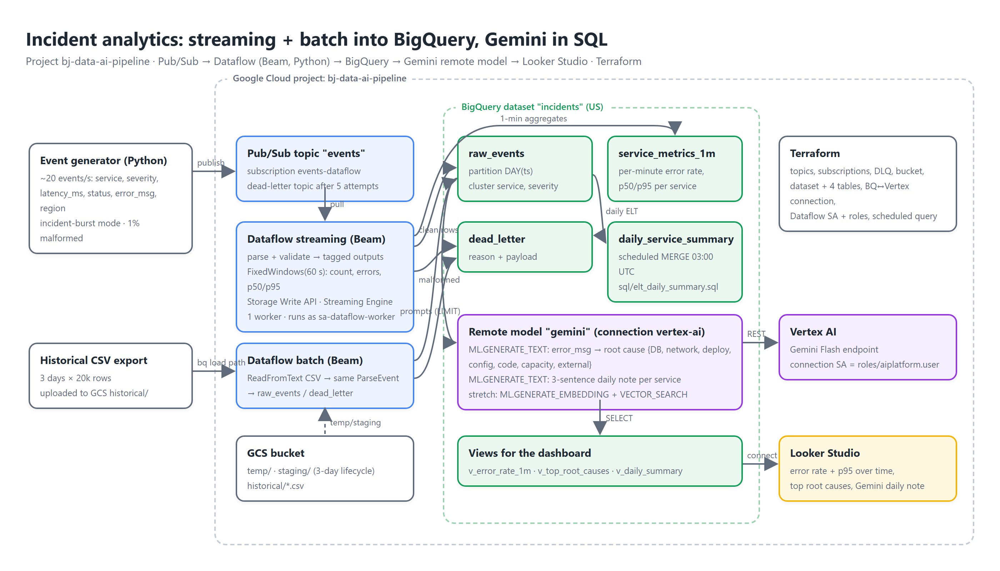

# Streaming + batch incident analytics with Gemini in BigQuery

[](demo/demo.mp4)

An incident and log analytics pipeline on Google Cloud: a Python generator publishes application events to **Pub/Sub**, a **Dataflow** streaming job (Apache Beam, Python) validates them into **BigQuery** with a dead-letter table and 1-minute windowed aggregates, a batch job backfills historical CSV from **GCS**, a scheduled query builds a daily summary (ELT), and **Gemini in BigQuery** (remote model over a Vertex AI connection, `ML.GENERATE_TEXT`) classifies error messages into root causes and writes daily incident notes. A **Looker Studio** dashboard sits on top. Everything is **Terraform**.

- Demo video: [`demo/demo.mp4`](demo/demo.mp4) · captions [`demo/captions.srt`](demo/captions.srt) · transcript [`demo/transcript.md`](demo/transcript.md)
- Docs site: [`docs/index.html`](docs/index.html)
- Project: `bj-data-ai-pipeline` · region `us-central1` · BigQuery location `US`
- **Rebuild from scratch, step by step (incl. org-policy overrides, Java for Beam, Looker Studio, teardown): [`REBUILD.md`](REBUILD.md)**

## Pipeline

| Stage | What | How |
|---|---|---|
| Ingest | ~20 events/s with realistic distributions, an incident-burst mode (one service: 35% errors, 5-10× latency, one dominant error) and 1% malformed messages | `generator/publish_events.py` (Faker, Pub/Sub client) |
| Stream | parse + validate → `raw_events` (partitioned by day, clustered by service/severity); bad records → `dead_letter` with the reason; `FixedWindows(60s)` per service → `service_metrics_1m` (events, errors, error rate, p50/p95) | `pipeline/streaming_pipeline.py`, Dataflow, Storage Write API, Streaming Engine, 1 worker, dedicated SA |
| Batch | historical CSV from GCS through the **same** `ParseEvent` transform → `raw_events` / `dead_letter` | `pipeline/batch_backfill.py` (Dataflow batch) |
| ELT | `daily_service_summary` MERGE (events, errors, error rate, p95, top error, regions) | `sql/elt_daily_summary.sql` as a BigQuery scheduled query (03:00 UTC) |
| AI | remote model `gemini` on the `vertex-ai` connection; `ML.GENERATE_TEXT` root-cause category per distinct error (LIMIT 200), 3-sentence daily note per service; stretch: `ML.GENERATE_EMBEDDING` + `VECTOR_SEARCH` | `sql/gemini_root_cause.sql`, `sql/vector_search.sql` |
| Visualize | error rate and p95 over time, top root causes, Gemini daily notes | Looker Studio on BigQuery views ([live report](https://lookerstudio.google.com/reporting/c3b19a12-5869-40df-8020-ac75333de2d5)) |

## Architecture

```
generator ─► Pub/Sub events ─► Dataflow streaming (Beam) ─┬─► BQ raw_events
                      └─► events-dlq (5 attempts)          ├─► BQ service_metrics_1m (60 s windows)
GCS historical/*.csv ─► Dataflow batch (Beam) ────────────┴─► BQ dead_letter
BQ scheduled query ─► daily_service_summary
BQ remote model (connection vertex-ai) ─► Vertex AI Gemini ─► error_root_cause, daily_incident_summary
Looker Studio ─► views
```

## Repository layout

```
generator/        publish_events.py (streaming source, burst mode), make_historical_csv.py (batch source)
pipeline/         streaming_pipeline.py, batch_backfill.py, test_pipeline.py (Beam TestPipeline unit tests)
sql/              elt_daily_summary.sql, gemini_root_cause.sql, vector_search.sql, views.sql
terraform/        Pub/Sub (topic, subscription, DLQ, IAM), GCS, BigQuery dataset/tables/connection,
                  Dataflow worker SA + roles, scheduled query
deploy.sh         infra | stream | generate | backfill | elt | gemini | stop | destroy
demo/             recorder.py + scenes.py: automated demo video with Cloud Text-to-Speech narration
docs/             architecture diagram + docs site
```

## Run it

```bash
python -m venv .venv && source .venv/bin/activate
pip install -r pipeline/requirements.txt -r generator/requirements.txt
cp terraform/terraform.tfvars.example terraform/terraform.tfvars    # project, your email (Dataflow actAs)

./deploy.sh infra        # Terraform
./deploy.sh stream       # Dataflow streaming job (takes ~3 min to start)
./deploy.sh generate     # 4 minutes of events with a 90 s incident burst
./deploy.sh backfill     # historical CSV -> Dataflow batch -> raw_events
./deploy.sh elt          # daily summary MERGE now
./deploy.sh gemini       # remote model + root-cause classification + daily notes
./deploy.sh stop         # drain the streaming job (the main cost)
./deploy.sh destroy
```

> **Org policy note.** If your organization enforces domain-restricted sharing (`iam.allowedPolicyMemberDomains`) and you work from a consumer (gmail) account, BigQuery cannot create the anonymous result datasets it owns on your behalf and every `bq query` fails with "users named in the policy do not belong to a permitted customer". For this sandbox project the constraint is overridden at project level (`gcloud org-policies set-policy` with `allowAll: true`); in a company org you would run the SQL steps as a service account instead.

Local test of the streaming logic without Dataflow: `python pipeline/streaming_pipeline.py --project <p> --runner DirectRunner --streaming` (reads the real subscription). Unit tests: `cd pipeline && python -m pytest -q`.

## Security

- Dataflow runs as `sa-dataflow-worker` (dataflow.worker, bigquery.dataEditor/jobUser, pubsub.subscriber/viewer, objectAdmin on the pipeline bucket only), not the Compute default SA. The operator needs `iam.serviceAccountUser` on it; Terraform grants that to `operator_email`.
- The BigQuery connection's service account has exactly `roles/aiplatform.user`.
- Dataflow workers have **no external IPs** (`--no_use_public_ips`, required by the org policy `compute.vmExternalIpAccess`) and run in a dedicated subnet with Private Google Access; no Cloud NAT because the pipeline needs nothing from the public internet.
- The generator runs with your ADC login; no keys anywhere.
- Bucket: uniform bucket-level access, public access prevention, 3-day lifecycle on temp/staging.
- Pub/Sub dead-letter policy and the BigQuery `dead_letter` table make bad data visible instead of dropped.

## Cost and cleanup

Dataflow streaming is the only meaningful cost (~₹400-650/day if left running): run it for the demo and `./deploy.sh stop`. Pub/Sub and BigQuery stay in the free tier at this volume; the Gemini calls are bounded by `LIMIT 200` distinct errors and a few dozen daily-summary rows.

## Design notes (interview talking points)

- **Streaming vs batch through one transform:** `ParseEvent` is shared by both jobs, so "valid event" has a single definition; the batch job is just a different source.
- **Windowing:** 60-second fixed windows with 120 s allowed lateness and discarding accumulation: per-minute metrics are written once, late data lands in a corrected pane rather than blocking the window.
- **Dead-letter design at two levels:** Pub/Sub redelivery exhaustion → DLQ topic (transport problems); schema/validation failures → BigQuery `dead_letter` with the reason (data problems), queryable next to the good rows.
- **Partitioning + clustering:** day partitions on `ts` bound every query's scan; clustering by service/severity makes the dashboard and the Gemini prompt queries cheap.
- **Bringing Gemini to the data:** `ML.GENERATE_TEXT` in SQL avoids an export/ETL hop; cost is controlled by deduplicating error messages and limiting rows.
- **Thinking models and token caps:** Gemini 3.x reasons before it answers and those tokens count against `max_output_tokens`; a 16-token cap silently returned NULL for a few rows (surfaced as `unknown`). 256 for the one-word classifier and 1024 for the 3-sentence note fixed it.
- **Storage Write API:** exactly-once semantics for streaming inserts, no per-row streaming insert charge.

## How I built this

Code, Terraform, SQL and the demo pipeline were written with Claude Code and verified against the real project: Beam unit tests, a DirectRunner smoke test, the Dataflow jobs, the BigQuery tables and the Gemini outputs in the console.
